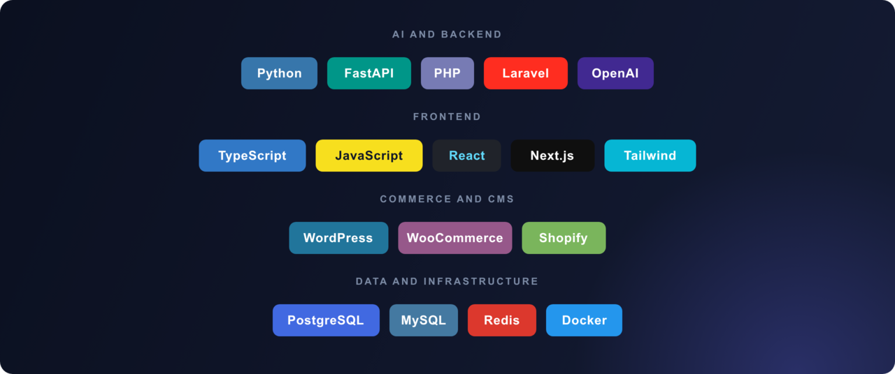

  <b>
  <a href="https://ali-raza-ten.vercel.app">PORTFOLIO</a> &nbsp;&#8226;&nbsp;
  <a href="https://linkedin.com/in/thealirazadev">LINKEDIN</a> &nbsp;&#8226;&nbsp;
  <a href="mailto:thealirazadev@gmail.com">EMAIL</a> &nbsp;&#8226;&nbsp;
  <a href="https://github.com/thealirazadev?tab=repositories">REPOSITORIES</a>
  </b>

## About

I am a Senior AI Engineer with 7+ years in production software. I build LLM systems for production: RAG with cited answers, multi-provider LLM APIs, and workflows with human review of model output. I treat the model as one part of a reliable system, with schema-validated LLM output, cost tracking, and eval suites in CI.

- AI open source: [llm-gateway](https://github.com/thealirazadev/llm-gateway) (multi-provider failover, race-safe budgets, cost tracking), [evalkit](https://github.com/thealirazadev/evalkit) (prompt regression testing), [ticket-triage](https://github.com/thealirazadev/ticket-triage) (LLM triage with an eval harness), [askdocs](https://github.com/thealirazadev/askdocs) (RAG with citations).
- Stack: Python, FastAPI, Claude, OpenAI, Gemini, PostgreSQL, ChromaDB, Redis, Docker.
- Background: 5 years of backend and full-stack work (Laravel, WordPress, Shopify) for clients in the US, UK and EU.
- Author and maintainer of open source projects across AI, Laravel, WordPress, Shopify, and Next.js.
- Based in Lahore, Pakistan and open to remote work.

## Tech Stack

## Featured Projects

**[hook-relay](https://github.com/thealirazadev/hook-relay)** &nbsp;&#183;&nbsp; *Laravel*  
Inbound webhook gateway with per-provider signature verification, at least once delivery, a dead
letter queue, and replay.

**[ticket-triage](https://github.com/thealirazadev/ticket-triage)** &nbsp;&#183;&nbsp; *Python, FastAPI*  
Triages support tickets with an LLM, with rule based routing, a labeled evaluation harness, and CI
accuracy gating.

**[bookline](https://github.com/thealirazadev/bookline)** &nbsp;&#183;&nbsp; *Next.js, TypeScript*  
Appointment booking with timezone and DST correct slots, and database level double booking
prevention.

**[pulse-analytics](https://github.com/thealirazadev/pulse-analytics)** &nbsp;&#183;&nbsp; *Next.js, TypeScript*  
Privacy first, cookieless web analytics with rollup aggregation, goals, and a dashboard.

**[laravel-uptime](https://github.com/thealirazadev/laravel-uptime)** &nbsp;&#183;&nbsp; *Laravel*  
Uptime and SSL monitor with queued checks, flap suppression, public status pages, and alerting.

**[evalkit](https://github.com/thealirazadev/evalkit)** &nbsp;&#183;&nbsp; *Python*  
CLI for prompt regression testing with deterministic assertions and LLM as judge scoring.

Each of these has real tests and passing CI.

## Get in touch

I am open to senior full stack, AI engineering, and e-commerce roles, contract or full time.

- Portfolio: https://ali-raza-ten.vercel.app
- LinkedIn: https://linkedin.com/in/thealirazadev
- Email: thealirazadev@gmail.com
